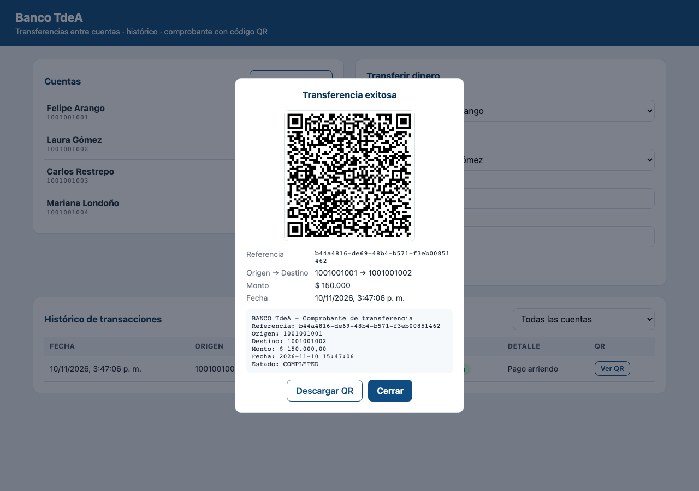
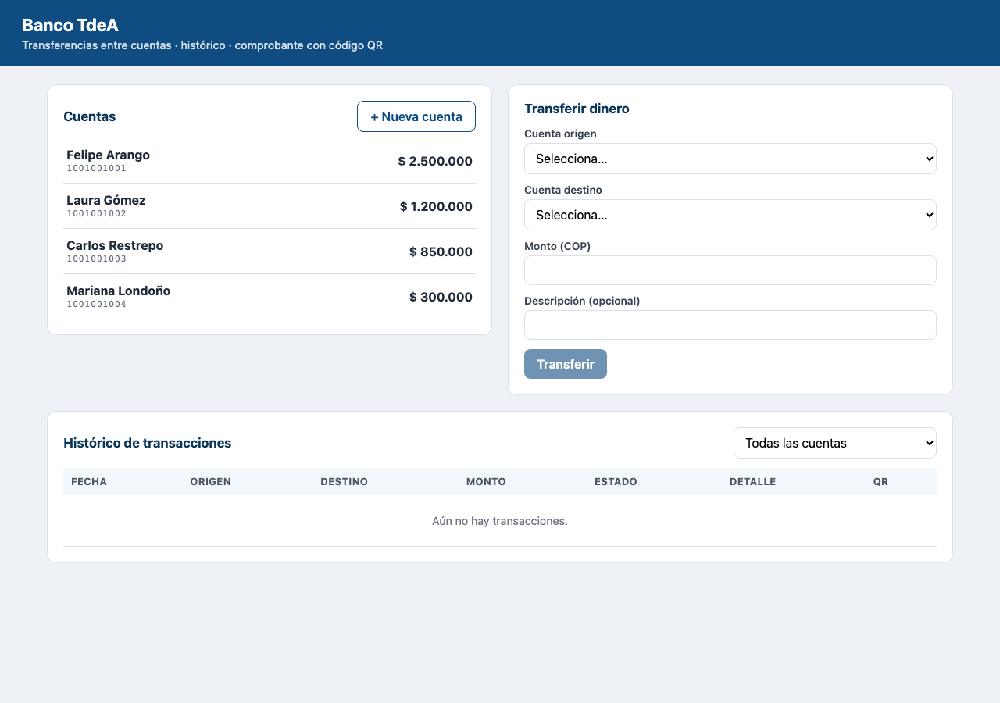
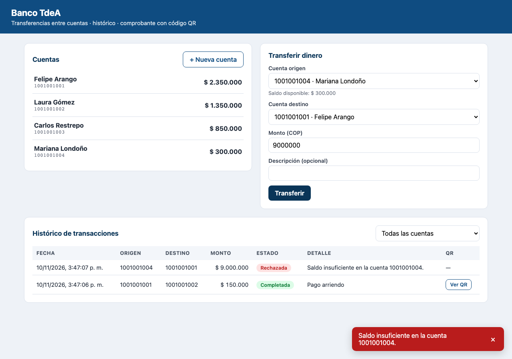
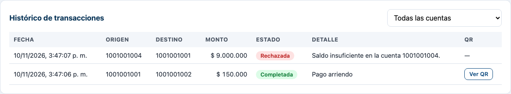
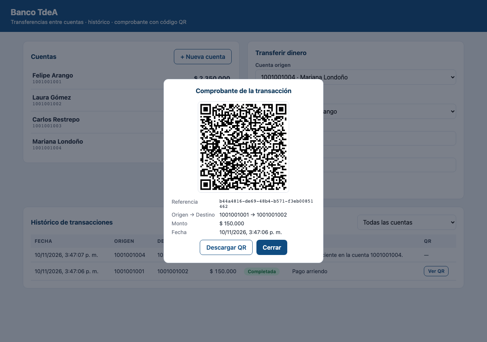
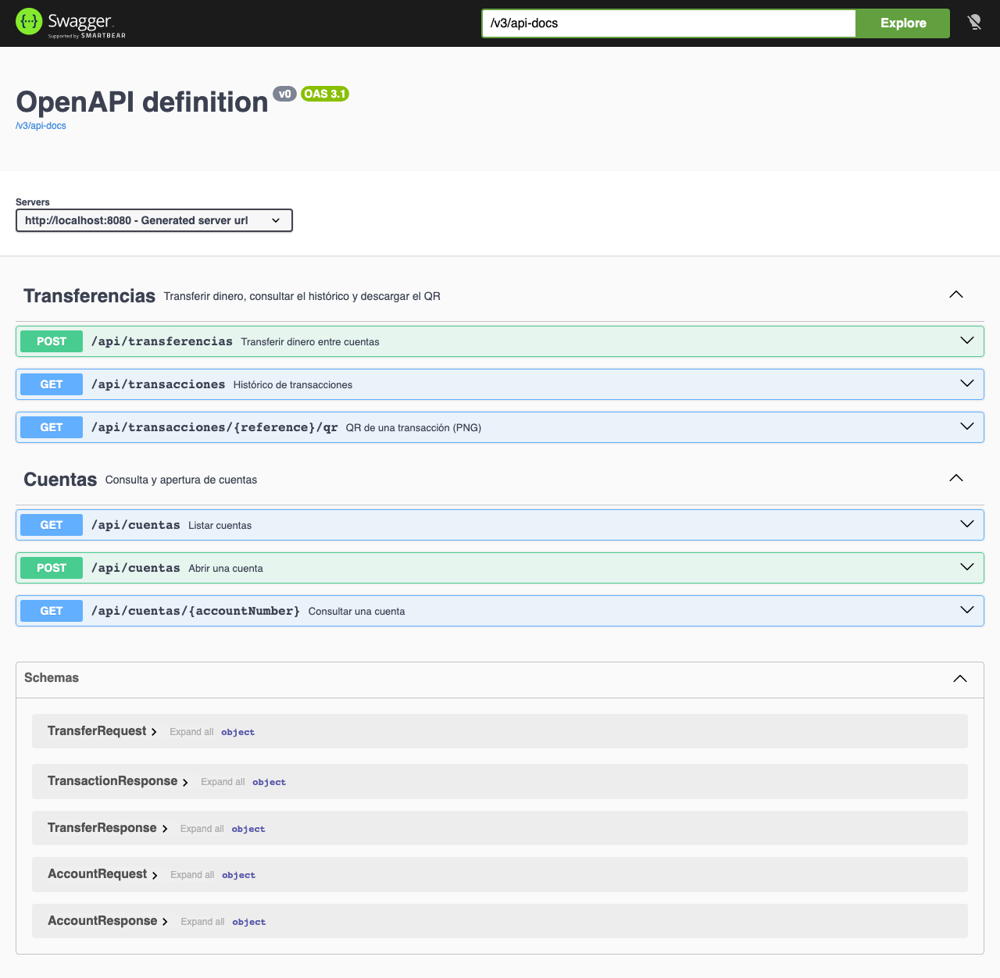
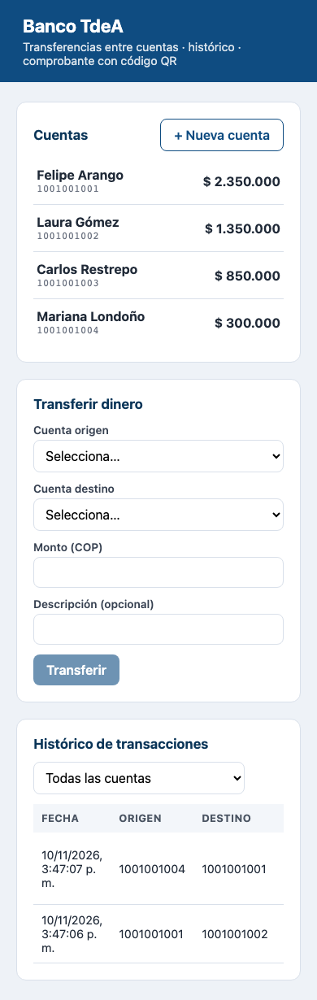

# BancoTransferencias — Transferencias entre cuentas con QR

Ejercicio propuesto del *Laboratorio Spring Boot con IA* · Aplicaciones FullStack · Tecnológico de Antioquia 2026.

Aplicación full stack para **trasladar dinero entre cuentas de un banco**, con **histórico de transacciones** y, al
completar cada transferencia, un **código QR** que codifica los datos básicos de la transacción.



## Funcionalidades

- Listar cuentas con su saldo y abrir cuentas nuevas.
- Transferir dinero entre dos cuentas con reglas de negocio: las cuentas deben existir, ser distintas, el monto debe
  ser mayor que cero y la cuenta origen debe tener saldo suficiente.
- Comprobante con QR (referencia, origen, destino, monto, fecha y estado), descargable como PNG.
- Histórico completo (completadas **y** rechazadas con su motivo), con filtro por cuenta y QR de cada movimiento.
- Errores del backend mostrados en un *toast*.
- Swagger UI para probar la API.

## Capturas

| | |
|---|---|
| <br>**01 · Inicio:** cuentas con saldo, formulario e histórico. | <br>**02 · Transferencia exitosa** con su código QR y los datos codificados. |
| <br>**03 · Transferencia rechazada** por saldo insuficiente (toast). | <br>**04 · Histórico** de transacciones completadas y rechazadas. |
| <br>**05 · QR desde el histórico** de un movimiento. | <br>**06 · Swagger UI** con los endpoints documentados. |
| <br>**07 · Vista móvil** adaptada a pantallas pequeñas. | |

## Stack tecnológico

| Capa | Tecnología |
|---|---|
| Backend | Java 21 (compatible con 25), Spring Boot 4.1, Spring Web MVC, Spring Data JPA / Hibernate, Bean Validation |
| Base de datos | PostgreSQL 16 (H2 en memoria para pruebas y perfil `h2`) |
| QR | ZXing 3.5.4 |
| Documentación API | springdoc-openapi 3 (Swagger UI) |
| Frontend | React 19, TypeScript, Vite, Axios |
| Herramientas | Maven, Git/GitHub, Claude Code / Cursor (reglas en `.cursor/rules/springboot.mdc`) |

## Arquitectura

```
React (localhost:3000)
   │  Axios + VITE_API_URL
   ▼
Controller  ── valida (@Valid) y elige el código HTTP
   ▼
Service     ── reglas de negocio, transacciones, QR
   ▼
Repository  ── Spring Data JPA (bloqueo PESSIMISTIC_WRITE en cuentas)
   ▼
PostgreSQL  ── tablas accounts y transactions
```

Decisiones de diseño:

- **Dinero con `BigDecimal`** (precisión 19, escala 2).
- **Atomicidad**: débito, crédito y registro ocurren en una sola transacción de BD; las cuentas se bloquean siempre en el
  mismo orden para evitar *deadlocks* entre transferencias cruzadas.
- **Histórico completo**: si una regla falla se hace *rollback* y el intento se guarda aparte (`REQUIRES_NEW`) como
  `REJECTED` con su motivo.
- **Errores estándar**: jerarquía `sealed` de excepciones traducida a `ProblemDetail` (RFC 9457).
- **DTOs como `record`**; las entidades no salen de la capa de servicio.

## API REST

Base: `http://localhost:8080/api` · Swagger: `http://localhost:8080/swagger-ui.html`

| Método | Ruta | Descripción | Respuestas |
|---|---|---|---|
| GET | `/cuentas` | Lista las cuentas | 200 |
| GET | `/cuentas/{numero}` | Consulta una cuenta | 200, 404 |
| POST | `/cuentas` | Abre una cuenta | 201, 400, 409 |
| POST | `/transferencias` | Transfiere y devuelve el QR | 201, 400, 404, 422 |
| GET | `/transacciones?cuenta=` | Histórico (filtro opcional) | 200 |
| GET | `/transacciones/{referencia}/qr` | PNG del QR | 200, 400 |

```bash
curl -X POST http://localhost:8080/api/transferencias -H "Content-Type: application/json" \
  -d '{"sourceAccount":"1001001001","targetAccount":"1001001002","amount":150000,"description":"Pago arriendo"}'
```

## Cómo ejecutarlo

Requisitos: JDK 21+, Maven 3.9+ (o el de IntelliJ), Node 20+ y Docker (o usar el perfil H2).

**1. Base de datos** — opción A (PostgreSQL con Docker, base `banktdea`, usuario `postgres`, clave `root`):

```bash
docker compose up -d
```

Si ya tienes un PostgreSQL local en el puerto 5432, publica el contenedor en otro puerto con `DB_PORT=5433 docker compose up -d`
y ajusta `DB_URL` en `backend/.env` (`jdbc:postgresql://localhost:5433/banktdea`).

Opción B (sin instalar nada): arrancar el backend con el perfil `h2` (los datos se pierden al detenerlo).

**2. Backend**

```bash
cd backend
cp .env.example .env        # ajusta DB_PASSWORD si hace falta
mvn spring-boot:run         # o: mvn spring-boot:run -Dspring-boot.run.profiles=h2
mvn test                    # pruebas de integración (H2)
```

Al iniciar se cargan 4 cuentas de ejemplo (`app.seed-data=true`).

**3. Frontend**

```bash
cd frontend
cp .env.example .env        # VITE_API_URL=http://localhost:8080
npm install
npm run dev                 # http://localhost:3000
```

## Estructura

```
BancoTransferencias/
├── .cursor/rules/springboot.mdc   Reglas de Cursor
├── docker-compose.yml             PostgreSQL
├── backend/                       API Spring Boot (co.edu.tdea.banktransfer)
├── frontend/                      SPA React + TypeScript + Vite
└── docs/                          Informe, prompts y capturas
```

## Entregables

- Código: este repositorio.
- Informe: [`docs/Informe_Transferencias_Bancarias.pdf`](docs/Informe_Transferencias_Bancarias.pdf)
- Prompts utilizados: [`docs/PROMPTS.md`](docs/PROMPTS.md)
- Evidencia en PostgreSQL (salida de `psql`): [`docs/evidencia_postgres.txt`](docs/evidencia_postgres.txt)
- Capturas: [`docs/capturas/`](docs/capturas)
